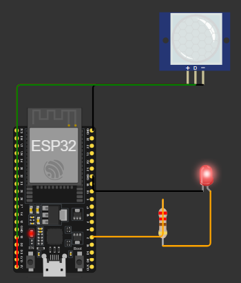
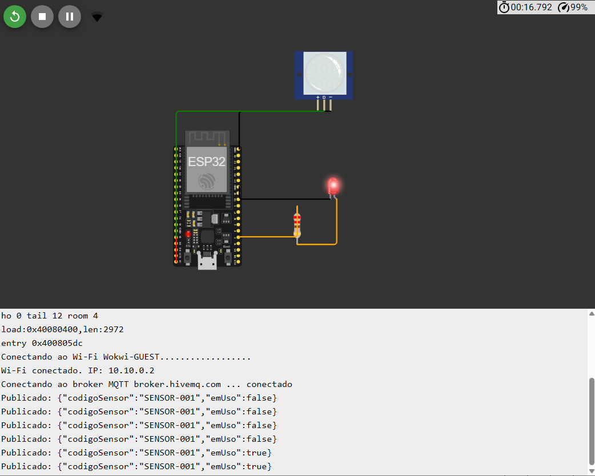

# Smart Gym – Dispositivo IoT (ESP32 + Sensor PIR)

Dispositivo IoT do **Smart Gym**: um ESP32 com sensor de presença PIR instalado em um equipamento da academia. Ele detecta se o aparelho está em uso e transmite a leitura via Wi-Fi, pelo protocolo MQTT, para um broker. O backend em Spring Boot assina esse tópico e grava as leituras no banco de dados.

**Simulação no Wokwi:** https://wokwi.com/projects/481707774555508737

## 1. Projeto

| | |
|---|---|
| **Projeto** | Smart Gym – Dispositivo IoT |
| **Tema** | Gestão inteligente de academias com monitoramento IoT da ocupação dos equipamentos |
| **Curso / Disciplina** | FATEC – DSM – Laboratório de Desenvolvimento Multiplataforma (Entrega Final – AV2) |
| **Repositório** | https://github.com/kaikdev/smart-gym |

## 2. Integrantes e divisão de responsabilidades

| Integrante | Responsabilidade no projeto |
|---|---|
| Kaik Silva Sousa | Entidades `Usuario` e `Plano` |
| Robert Guimarães Silva | Entidades `Exercicio` e `Equipamento` (equipamento ligado ao sensor IoT) |
| Gabriel Vasques de Abreu | Entidades `Treino` e `AvaliacaoFisica` |
| Andrey de Mendonça | Entidades `Agendamento` e `Pagamento` |

## 3. Problema resolvido

Em uma academia, o aluno só descobre que um aparelho está ocupado quando chega nele, o que gera filas e perda de tempo. Com um sensor de presença em cada equipamento, o sistema sabe em tempo real se o aparelho está **livre** ou **em uso** e mostra essa informação no aplicativo. As leituras também geram um histórico de uso, que ajuda a gestão a planejar manutenção e compras.

## 4. Componentes e circuito

| Componente | Quantidade | Função |
|---|---|---|
| ESP32 DevKit C v4 | 1 | Microcontrolador com Wi-Fi |
| Sensor de presença PIR HC-SR501 | 1 | Detecta movimento no aparelho |
| LED vermelho | 1 | Indica localmente que o aparelho está em uso |
| Resistor 220 Ω | 1 | Limita a corrente do LED |
| Protoboard e jumpers | – | Montagem do circuito |

### Ligações

| De | Para |
|---|---|
| PIR VCC | ESP32 5V |
| PIR GND | ESP32 GND |
| PIR OUT | ESP32 GPIO 13 |
| ESP32 GPIO 2 | Resistor 220 Ω → anodo do LED |
| Catodo do LED | ESP32 GND |

### Esquema no Wokwi



### Simulação em funcionamento



## 5. Funcionamento

1. O ESP32 conecta ao Wi-Fi e ao broker MQTT público HiveMQ.
2. A cada volta do `loop()`, lê o sensor PIR. Quando há movimento, o aparelho passa a ser considerado **em uso** e o LED acende.
3. O aparelho continua em uso por **30 segundos depois do último movimento**, porque quem está treinando nem sempre se mexe o tempo todo. Cada novo movimento recomeça a contagem.
4. A leitura é publicada no tópico a cada **2 segundos** e também **imediatamente quando o estado muda**.
5. Se o Wi-Fi ou o broker caírem, o ESP32 reconecta sozinho, sem travar a leitura do sensor.

### Mensagem MQTT

| | |
|---|---|
| Broker | `broker.hivemq.com`, porta `1883` (TCP) |
| Tópico | `fatec-dsm/smartgym/sensores/presenca` |
| Formato | JSON |

```json
{"codigoSensor":"SENSOR-001","emUso":true}
```

### Entidade gravada no backend

O backend tem um serviço listener (`SensorMqttListener`) que assina o tópico e, para cada mensagem, grava uma `LeituraSensor` no MySQL, usando a entidade, o repositório e o serviço criados para esse tipo de elemento:

| Entidade | Tabela | Campos |
|---|---|---|
| `LeituraSensor` | `leituras_sensor` | id (Long), codigoSensor (String), emUso (Boolean), dataHoraLeitura (LocalDateTime), equipamentoId (Long) |

Se existir um equipamento cadastrado com o mesmo **Código do sensor IoT** (`SENSOR-001`), o campo `emUsoIot` dele também é atualizado. As leituras podem ser consultadas em `GET /api/leituras-sensor`.

## 6. Arquivos

| Arquivo | Conteúdo |
|---|---|
| `sketch.ino` | Código do ESP32 (Arduino / C++) |
| `diagram.json` | Circuito do Wokwi |
| `libraries.txt` | Bibliotecas usadas no Wokwi (`PubSubClient`) |
| `esquema-wokwi.png` | Imagem do esquema do circuito |
| `simulacao-wokwi.png` | Imagem da simulação em funcionamento |

## 7. Variáveis de configuração

O dispositivo não usa variáveis de ambiente. As configurações são constantes no início do `sketch.ino`:

| Constante | Valor | Descrição |
|---|---|---|
| `WIFI_SSID` | `Wokwi-GUEST` | Nome da rede Wi-Fi (no dispositivo físico, use a rede local de 2.4 GHz) |
| `WIFI_SENHA` | vazio | Senha da rede Wi-Fi |
| `WIFI_CANAL` | `6` | Canal da rede Wokwi-GUEST (no dispositivo físico, remova o canal do `WiFi.begin`) |
| `MQTT_BROKER` | `broker.hivemq.com` | Endereço do broker MQTT |
| `MQTT_PORTA` | `1883` | Porta do broker |
| `MQTT_TOPICO` | `fatec-dsm/smartgym/sensores/presenca` | Tópico de publicação (deve ser igual ao do backend) |
| `CODIGO_SENSOR` | `SENSOR-001` | Identificador do sensor (deve ser igual ao código cadastrado no equipamento) |
| `PINO_PIR` / `PINO_LED` | `13` / `2` | Pinos do sensor e do LED |
| `INTERVALO_ENVIO_MS` | `2000` | Intervalo entre publicações |
| `TEMPO_EM_USO_MS` | `30000` | Tempo em uso após o último movimento |

## 8. Usuários e senhas para teste

O dispositivo não tem login: o broker HiveMQ público não exige usuário nem senha. Para conferir as leituras no sistema:

| Perfil | E-mail | Senha |
|---|---|---|
| Administrador | `admin@smartgym.com` | `admin123` |
| Aluno | `aluno@smartgym.com` | `aluno123` (crie pela tela de registro do app) |

## 9. Instruções para execução

### No Wokwi

1. Acesse https://wokwi.com/projects/481707774555508737 (ou crie um projeto ESP32 e cole o conteúdo de `sketch.ino` e `diagram.json`, adicionando a biblioteca `PubSubClient` no Library Manager).
2. Clique em **▶ Start**. O Serial Monitor mostra `Wi-Fi conectado`, `Conectando ao broker MQTT broker.hivemq.com ... conectado` e as linhas `Publicado: {...}`.
3. Clique no sensor PIR e depois em **Simulate motion**. O LED acende e as mensagens passam a sair com `"emUso":true`.
4. Se aparecer o erro `Connection to IoT Gateway failed` no ícone de Wi-Fi, recarregue a página ou abra o projeto em uma aba anônima, sem extensões do navegador.

### Integração com o sistema

1. Inicie o backend (veja o README do backend). No log devem aparecer `Conectado ao broker MQTT` e `Inscrito no topico fatec-dsm/smartgym/sensores/presenca`.
2. No app, entre como administrador e cadastre um equipamento com **Código do sensor IoT = `SENSOR-001`**.
3. Com a simulação rodando, acione o sensor. No log do backend aparece `Leitura gravada: sensor=SENSOR-001 emUso=true`.
4. No app, clique em **Atualizar status dos equipamentos**: o equipamento aparece **Em uso**.

### No dispositivo físico

1. No Arduino IDE, instale o pacote de placas **esp32** (Espressif) e a biblioteca **PubSubClient** (Nick O'Leary).
2. Copie `sketch.ino` para uma pasta `sensor_presenca`, com o nome `sensor_presenca.ino`.
3. Altere `WIFI_SSID` e `WIFI_SENHA` para a rede local (2.4 GHz) e troque `WiFi.begin(WIFI_SSID, WIFI_SENHA, WIFI_CANAL)` por `WiFi.begin(WIFI_SSID, WIFI_SENHA)`.
4. Monte o circuito conforme a tabela de ligações, selecione a placa **ESP32 Dev Module** e faça o upload.
5. Ajuste os potenciômetros do HC-SR501 se precisar mudar a sensibilidade ou o tempo de detecção.

**Tecnologias:** ESP32, Arduino (C++), bibliotecas WiFi e PubSubClient, MQTT, broker HiveMQ e Wokwi.
